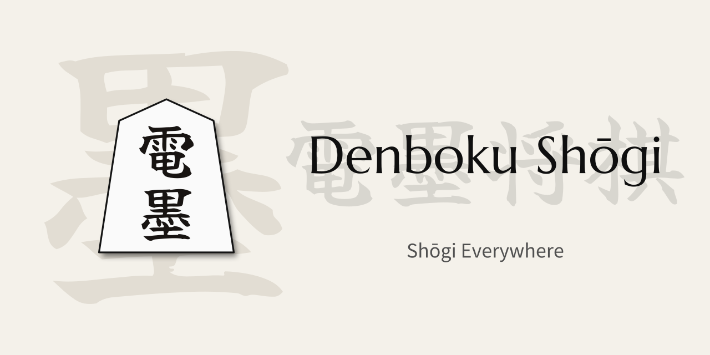
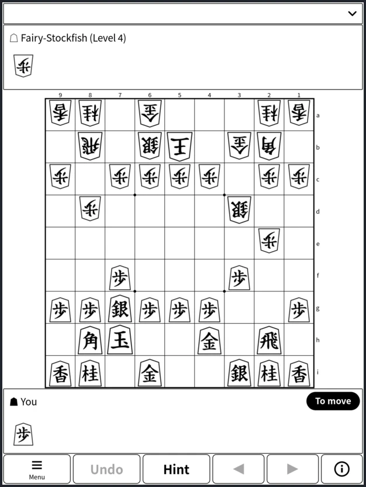
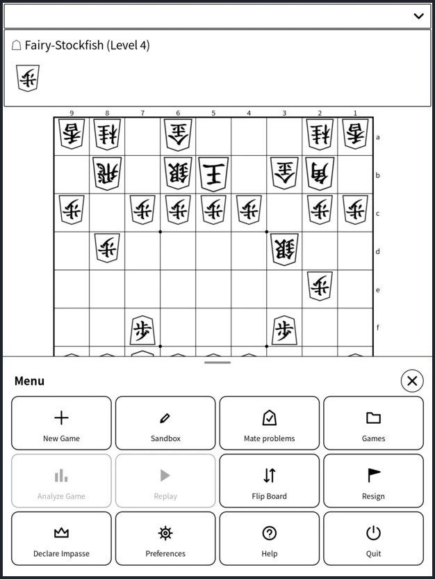
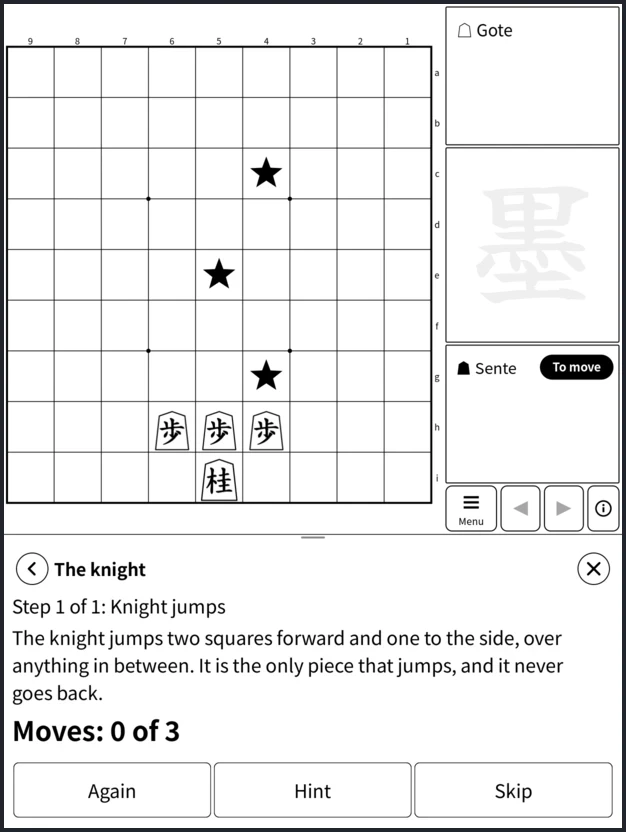
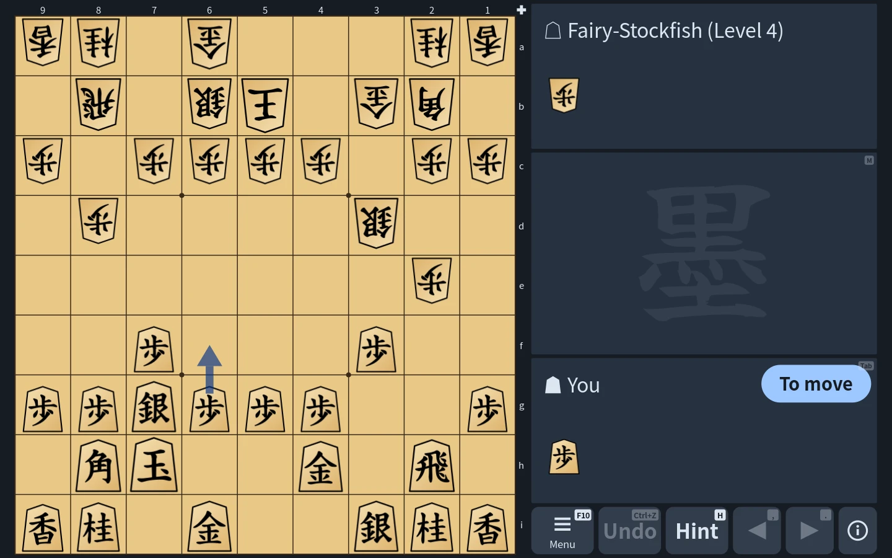
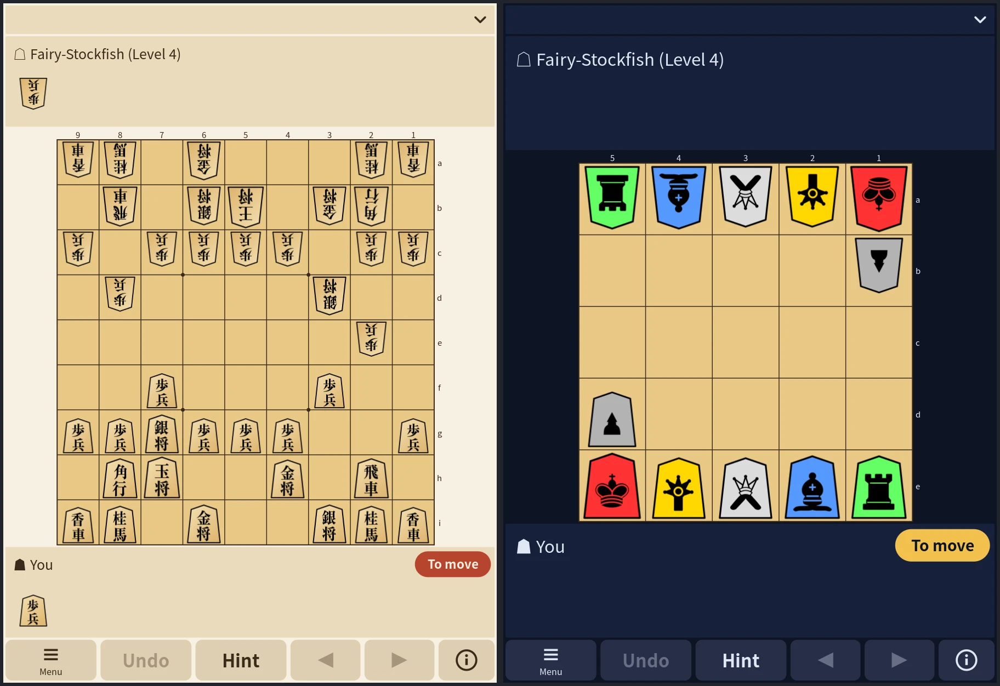
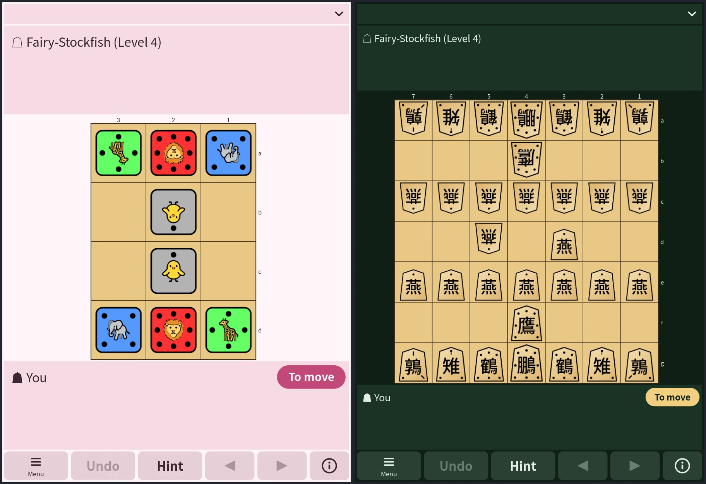

# 電墨将棋 Denboku Shōgi

Shōgi for jailbroken Kindles, made for e-ink. It runs on Linux, Windows and Android too.

You can play the computer, a friend on the same device or over the network, or people on [Lishogi](https://lishogi.org). Only the online games need a connection.

<p>



</p>

## What's in it

- Nine variants: standard shōgi, Minishōgi, Kyotoshōgi, Checkshōgi, Dōbutsu, Goro Goro, Tori shōgi, Judkins shōgi and Euroshōgi. The engine plays all of them.
- Handicap games, clocks (byoyomi, increment, sudden death), hints and undo.
- A tutorial played on the board, from how the pieces move to castles, openings and tesuji, and 400 tsume problems.
- Game analysis with an evaluation graph, mistakes marked and the engine's best moves; openings and castles named as they come up.
- LAN games with chat (the room shows up by itself, no address to type), internet games by address, Lishogi and CSA servers like Floodgate.
- KIF, CSA and SFEN, a history of your last 200 games, copy and paste to and from Lishogi.
- A sandbox to set up any position.
- Ten piece sets, twelve color palettes, a wooden board, colors for color blindness and ten synthesized sound sets. You can add your own pieces and sounds.
- Keyboard and game controller, with every key and button rebindable.
- English, Japanese and Brazilian Portuguese.

On the Kindle it keeps to black and white, redraws only what changed and has big touch targets. It starts from KUAL or from a shortcut in the library.

## Screenshots







## Install

Get the file for your device from the [latest release](https://github.com/Jefik/denboku-shogi/releases/latest).

| Device                                   | File                                                                 | How                                                                                                                                                                                         |
| ---------------------------------------- | -------------------------------------------------------------------- | ------------------------------------------------------------------------------------------------------------------------------------------------------------------------------------------- |
| Kindle (jailbroken, with KUAL or Jobman) | `denboku-kindle.zip`                                                 | Unpack it and copy the `denboku/` folder to `/mnt/us/extensions/` on the Kindle. Open KUAL → **電墨将棋 Denboku Shōgi → Play**. **Add shortcut to the library** puts it in the library too. |
| Linux x86_64                             | `Denboku-x86_64.AppImage`                                            | `chmod +x Denboku-x86_64.AppImage`, then run it.                                                                                                                                            |
|                                          | `denboku-linux.tar.xz`                                               | Unpack it and run `denboku-linux/denboku.sh`.                                                                                                                                               |
|                                          | `Denboku-x86_64.flatpak`                                             | `flatpak install --user Denboku-x86_64.flatpak` (needs the `org.freedesktop.Platform//24.08` runtime).                                                                                      |
| Linux ARM64                              | `denboku-linux-arm64.tar.xz`                                         | Unpack it and run `denboku-linux/denboku.sh`.                                                                                                                                               |
| Windows x64 (ARM through emulation)      | `denboku-windows.zip`                                                | Unpack it into a folder of its own and run `Denboku.exe`. Keep the folders next to it.                                                                                                      |
| Android 7+                               | `Denboku.apk` (arm64), `Denboku-x86_64.apk` (emulators, Chromebooks) | Open it on the device and allow installing from unknown sources, or `adb install`.                                                                                                          |

The game can check GitHub for new versions and update itself (the Flatpak does not yet); it asks the first time. See [`docs/INSTALL.md`](docs/INSTALL.md) for more on each platform and [`docs/MANUAL.md`](docs/MANUAL.md) for how to play.

## Code signing policy

Free code signing provided by [SignPath.io](https://about.signpath.io), certificate by [SignPath Foundation](https://signpath.org). The Windows files are built from this repository by GitHub Actions and signed only after a release is approved.

Committers, reviewers and approvers: [Jefik](https://github.com/Jefik).

Privacy: the game collects no data and sends nothing about you. It goes online only when you ask it to: to check for new versions (after asking you the first time), to play on Lishogi or a CSA server, and to play over the local network.

## Build from source

C11 and GTK 2. The submodules (curl, mbed TLS, gdk-pixbuf) are only needed for the Android and Windows packages:

```sh
git clone --recurse-submodules --shallow-submodules https://github.com/Jefik/denboku-shogi.git
```

### Linux

Needs a C compiler, `make`, `pkg-config` and the GTK 2 development files (Debian/Ubuntu: `build-essential pkg-config libgtk2.0-dev`; Arch: `gtk2`; Fedora: `gtk2-devel`).

```sh
make -j"$(nproc)"     # build/denboku
make test             # rules, notation, network and layout tests, no GTK needed
```

To run it from the source tree, point it at `data/` and at an engine:

```sh
DENBOKU_BASE=data DENBOKU_ENGINE=/path/to/fairy-stockfish build/denboku
```

The engine is [Fairy-Stockfish](https://github.com/fairy-stockfish/Fairy-Stockfish) built with `largeboards=yes` (or its `largeboard` release).

### On Windows

In PowerShell, with [Git](https://git-scm.com/download/win):

```powershell
git clone --recurse-submodules --shallow-submodules https://github.com/Jefik/denboku-shogi.git
cd denboku-shogi
powershell -ExecutionPolicy Bypass -File tools\build-windows.ps1
```

The first run downloads MSYS2 (the compiler and GTK 2, about 1 GB) into `build\msys64` inside the repo, without installing anything on the system, and builds the engine too; later runs only rebuild. The result is `dist\denboku-windows\Denboku.exe` and `dist\denboku-windows.zip`. Deleting `build\` removes everything it downloaded.

### Release packages

`tools/build.sh` runs the tests and builds the packages: Linux by default, or `kindle`, `windows`, `android`, `all`, `--release`. It needs Docker and some inputs prepared beforehand; [`docs/BUILD.md`](docs/BUILD.md) has the details and [`docs/CODE.md`](docs/CODE.md) how the code is laid out.

## Licenses

Code: GPLv3 (`LICENSE`). Monocypher (`src/third_party/`): BSD-2 or CC0. The packages carry GTK 2, cairo and Pango (LGPL) and curl; the Windows one has gdk-pixbuf built from `third_party/gdk-pixbuf` with only its PNG loader. The APK carries Termux's packages and curl on mbed TLS (Apache-2.0), built from the submodules in `third_party/`. Each is under its own license. Engine: Fairy-Stockfish, GPLv3. Fonts: Noto Sans JP, Symbols 2 and Emoji, Yuji Syuku, Zen Antique, SIL OFL 1.1 (`data/fonts/OFL-*.txt`). Gata Sōsho by gata, free to use, modify and share (`data/fonts/LICENSE-ShogiGata.txt`). Pictorial symbols: CouchTomato87, CC BY 4.0 (`data/fonts/LICENSE-ShogiIntl.txt`). peanatsu's shogi_printout (western symbols, with chess pieces by Colin M.L. Burnett and NikNaks and a lance by Orror/Zigeuner; cursive promoted pieces by Hari Seldon; piece colors; the high-contrast set): CC BY-SA 3.0 (`data/fonts/LICENSE-ShogiPrintout.txt`); its 2-kanji glyphs are AR PL UKai's, Arphic Public License (`data/fonts/ARPHICPL.TXT`), and its 1-kanji glyphs Un fonts', GPL-2 (`data/fonts/LICENSE-ShogiPrintoutKanji.txt`). Mate problems: Generated Tsume-Shogi by Shinta Nakayama, CC BY 4.0.
